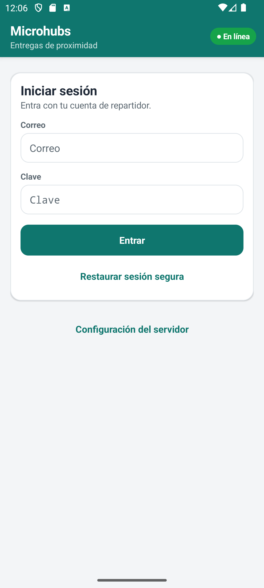
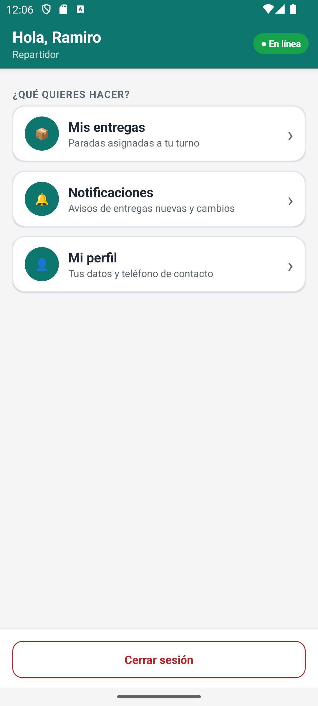
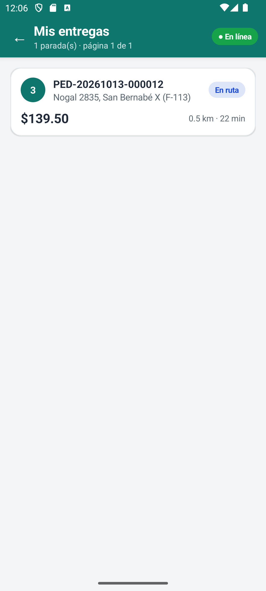
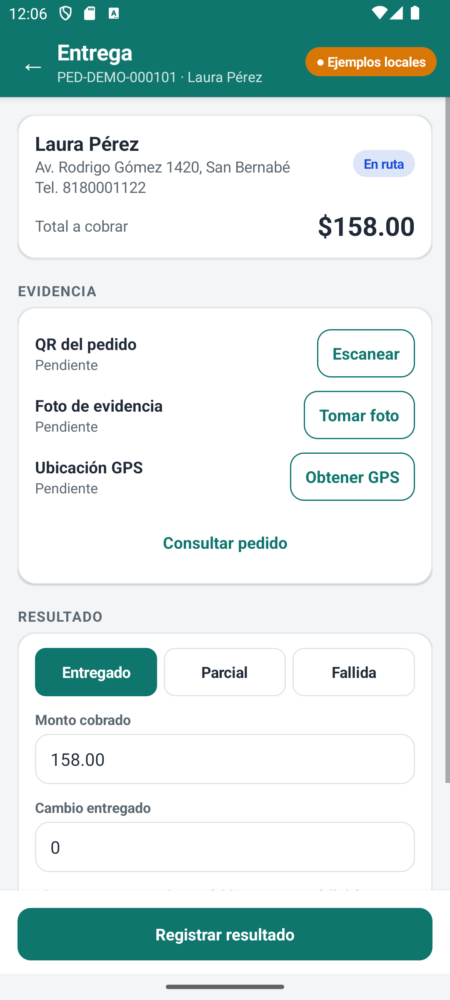
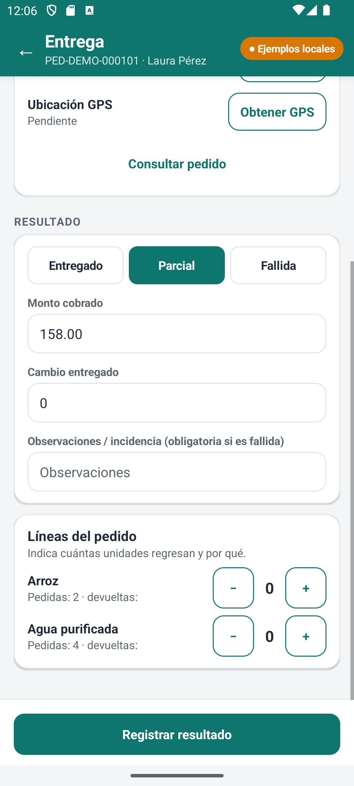
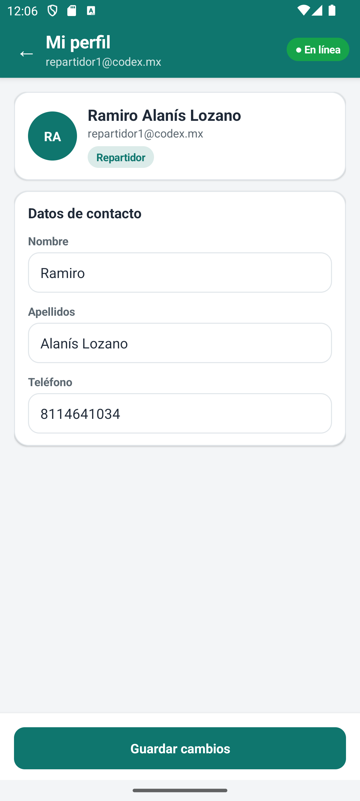

# Microhubs · Android (parte B)

Cliente Kotlin nativo, **exclusivamente JSON**, para la persona repartidora. Habla con los microservicios del contrato v1:
auth (5101), usuarios (5102), pedidos (5104), entregas (5105), documentos (5107) y seguimiento (5110, el rastro GPS).

Incluye: inicio y cierre de sesión (tokens cifrados con Android Keystore y renovación automática), **perfil editable** (nombre,
apellidos y teléfono), **mis entregas** con paginación, detalle de la entrega, escaneo del QR del pedido, **foto de evidencia a
resolución útil** (JPEG ≤ 1600 px, nunca más de 5 MB), GPS con la ruta recorrida, **cierre de entrega idempotente** (entregado,
parcial por líneas o fallida).

## Interfaz

Diseño propio sobre el tema Material del sistema (sin dependencias nuevas), con modo oscuro automático:

- **Barra superior** con título, botón de volver e **indicador de conexión en vivo** (En línea · Sin conexión · Ejemplos locales).
  Una barra de progreso fina avisa que hay una petición en curso y un aviso de color muestra errores, éxitos e información.
- **Inicio** con tarjetas de acción (entregas y perfil) y «Cerrar sesión» siempre a la mano.
- **Mis entregas** como tarjetas: número de parada, folio, dirección, estado con color, total, distancia y tiempo.
- **Entrega** en secciones: cliente y total a cobrar; evidencia (QR, foto y GPS con ✓ / pendiente y su botón); resultado con selector
  *Entregado · Parcial · Fallida*, campos rotulados y, en parcial, pasos − / + por línea con su motivo. El botón «Registrar
  resultado» queda fijo abajo y el formulario conserva lo escrito aunque se escanee, se tome la foto o se obtenga el GPS.
- **Perfil** con iniciales, rol y datos editables (el teléfono se valida a 10 dígitos antes de enviar).
- Ícono de la app, respeto de las barras del sistema (Android 15 dibuja bajo ellas) y botones de al menos 44 dp.

| Acceso | Inicio | Mis entregas | Entrega |
|---|---|---|---|
|  |  |  |  |

| Entrega parcial | Perfil |
|---|---|
|  |  |

## Compilar y ejecutar

Requiere JDK 17 o 21, Android SDK 35 y acceso a Google Maven/Maven Central la primera vez.

```powershell
./build.ps1          # compila, corre las pruebas unitarias y el lint; descarga Gradle 8.11.1 en .tools/ (ignorado por Git)
```

El APK queda en `app/build/outputs/apk/debug/app-debug.apk`.

### Conexión con el backend

- **Debug:** HTTP solo hacia un host fijado al compilar, por defecto `10.0.2.2` (el equipo, visto desde el emulador). Para un
  teléfono físico: `./build.ps1 -DebugHttpHost 192.168.1.20` (la IP de la PC en la red local) y permitir los puertos 5101–5110 en el
  firewall de Windows. Cualquier otro host exige HTTPS.
- **Release:** solo HTTPS; no existe la configuración de HTTP. No se desactiva la validación de certificados.
- En la pantalla de acceso se escribe el servidor (`http://10.0.2.2` por defecto en debug) o se marca «Usar ejemplos locales»
  (respuestas con la misma forma que el contrato, sin red, para ensayar la interfaz).

Backend para probar: `docker compose -f docker-compose.integrado.yml up --build -d` (ver `servicios/README.md`). Para dejar entregas en ruta: `docker compose -f docker-compose.integrado.yml exec entregas python pruebas/preparar_entregas.py --cantidad 3`.
Cuentas de demostración y clave: `sistema_web/README.md` (repartidor: `repartidor1@codex.mx`).

## Flujo de la demostración

1. En el portal web (o con `pruebas/preparar_entregas.py` del contenedor `entregas`) se asigna una entrega al repartidor → llega la notificación.
2. App: acceso → **Mis entregas** → abrir la parada (cliente, dirección, total y líneas).
3. Escanear el QR (el contenido debe ser el ID numérico del pedido), tomar la foto y obtener el GPS.
4. Elegir el resultado: *entregado* (el monto debe ser el total), *parcial* (unidades devueltas y motivo por línea) o *fallida*
   (incidencia obligatoria) → **Registrar resultado**.
5. En el portal web el pedido aparece cerrado y el cliente recibe su aviso.

### Idempotencia (reintentos sin duplicar)
Cada cierre lleva un `id_cliente_local` (UUID) que se genera una vez y **se conserva hasta el éxito** (también si la app se
cierra), junto con la evidencia ya subida. Si falla la red o el servidor, «Registrar resultado» se repite con el mismo UUID: el
servidor responde 201 (aplicada) o 200 con `duplicado: true` (ya estaba aplicada); ambas son éxito. Un 409 indica que otra
operación ya cerró la entrega. Un 422 (regla de negocio) permite corregir y reintentar con el mismo UUID.

### Sesión
El token de acceso dura 15 min. Ante un 401 se renueva **una sola vez** (las peticiones simultáneas comparten la renovación; el
token de renovación rota) y se repite la petición. Si la renovación falla se borran las credenciales y se vuelve al acceso. Al
cerrar sesión se revocan acceso y renovación en el servidor y se borran las credenciales locales aunque falle la red.

## Pruebas

| Qué | Cómo | Resultado verificado |
|---|---|---|
| Unitarias (JVM): protocolo, contrato, entregas, idempotencia, perfil (incluye PATCH→PUT) | `./build.ps1` o `gradle testDebugUnitTest` | 46 aprobadas |
| Contra los **servicios reales** (login, entregas, foto en MongoDB, GPS en el servicio de seguimiento, cierre, duplicado, revocación) | `MICROHUBS_BACKEND_HOST=127.0.0.1 MICROHUBS_CLAVE=… gradle testDebugUnitTest --tests "*BackendRealTest*"` (necesita 2 entregas en ruta: `preparar_entregas.py`; la de perfil edita el teléfono y lo restaura) | 3 aprobadas |
| En emulador Android 14 (Keystore, borradores, redimensión de foto, recorrido de todas las pantallas con ejemplos —incluida la edición del perfil— y contra el backend real; guarda las capturas) | `gradle connectedDebugAndroidTest -Pandroid.testInstrumentationRunnerArguments.clave=…` | 7 aprobadas |
| Lint | `./build.ps1` | 0 errores, 17 advertencias (versiones de dependencias, `commit()` de preferencias, recursos sin usar, `ExifInterface`; `InsecureBaseConfiguration` es el HTTP permitido solo en debug) |

Detalles, fechas y límites en [PRUEBAS_APPS.md](../app_escritorio/PRUEBAS_APPS.md).

## Límites conocidos
- La **captura real de cámara, el escaneo de un QR físico y la precisión del GPS** no se han ensayado en un teléfono: en emulador
  solo se probó el recorrido de pantallas y el procesamiento de la imagen.
- No hay cola offline: sin red no se puede cerrar la entrega (sí se reintenta sin duplicar cuando vuelve).
- El formulario no se conserva si Android destruye el proceso; sí se conservan el UUID y la evidencia ya subida.
- El emulador con GPU por software (`swiftshader_indirect`) a veces se cae durante las pruebas instrumentadas; es un problema del
  emulador, no de la app: se repite la corrida.
