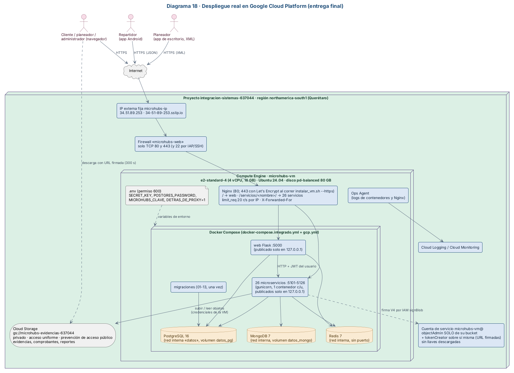
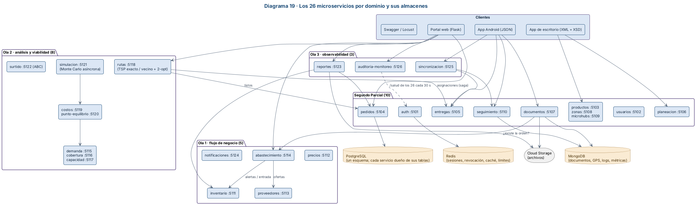
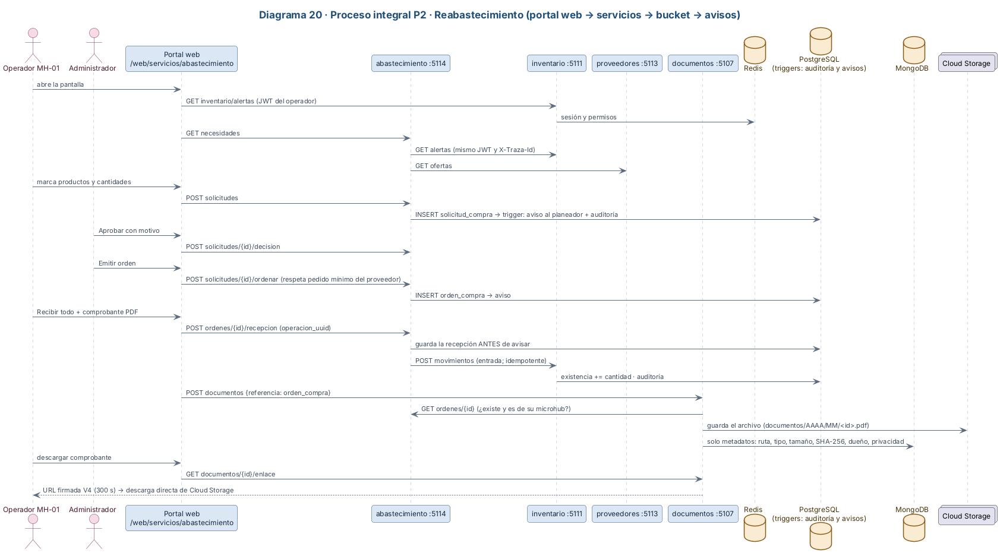
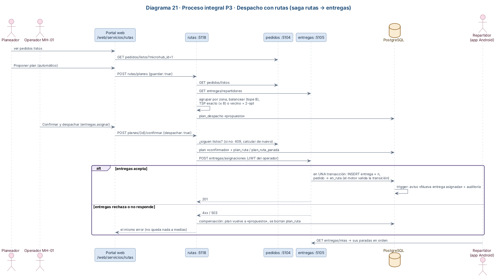

# 1. Portada

| | |
|---|---|
| **Proyecto** | Plataforma de Microhubs y Comercio de Proximidad |
| **Materia** | Integración de Aplicaciones Computacionales · Universidad de Monterrey |
| **Profesor** | Dr. Raúl Morales Saucedo |
| **Equipo** | Codex Innovations · Equipo 04 |
| **Integrantes** | Mauro Castillo Peña (613512) · Vanessa Morante López (654008) · María José Cedillo Mata (610256) · Ruth Elizabeth Soriano Barrera (637044) · Jorge Antonio Arreola Cantú (578560) |
| **Versión** | 5.0 · entrega final · 26 de noviembre de 2026 |
| **Despliegue** | https://34-51-89-253.sslip.io (GCP, northamerica-south1) |

Control de versiones: 1.x en el Primer Parcial (análisis, requerimientos, modelo y arquitectura); 4.3 en el Segundo Parcial
(`reporte_tecnico/Reporte_Tecnico_Segundo_Parcial_Equipo04.docx`); 5.0 en el Tercer Parcial y la entrega final (este documento).

# 2. Resumen ejecutivo

La plataforma apoya la decisión de abrir y operar una red de **microhubs** (microalmacenes de barrio) que surten pedidos de abarrotes
en cuatro colonias de San Bernabé, Monterrey. También opera el día a día:

- pedidos, asignación automática al microhub, preparación y entrega con evidencia y GPS;
- inventario y reabastecimiento con proveedores;
- precios por zona;
- rutas de reparto optimizadas;
- reportes y monitoreo.

Son **26 microservicios** (Flask, un contenedor cada uno), un **portal web**, una **app Android** (JSON) y una **app de escritorio**
(XML validado con XSD), sobre **PostgreSQL, MongoDB y Redis**, con archivos en **Google Cloud Storage**, desplegados en **Google Compute
Engine** detrás de Nginx.

Resultados principales:

- **Integración:** en la nube, tres procesos integrales de punta a punta con **32 de 32 pasos** por el portal (comprobados en las bases y en
  el bucket) y **40 de 40** por API. Además, 439 casos de petición y respuesta en local y 436 en la nube, todos aprobados.
- **Rendimiento:** con **100 000 pedidos y 1.4 millones de lecturas GPS**, las pruebas encontraron cuatro consultas lentas. Al
  corregirlas, la sincronización de demanda bajó de **37.5 s a 1.1 s** y los reportes de **1.1 s a 0.2 s**.
- **Carga (Locust) en la nube, 4 vCPU:**
  - 100 usuarios: p95 de 1.3 s y 0 % de errores;
  - satura con 200 usuarios (51 peticiones/s, 0.37 % de errores 503 en reportes);
  - al bajar la carga la mediana vuelve de inmediato.
- **Tolerancia a fallos:** con Redis, MongoDB, PostgreSQL, el bucket, un servicio o la red lenta fallando, el sistema responde 503 con
  traza, no deja datos a medias y se recupera sin reiniciar nada más (6 de 6 casos).
- **Respuesta de negocio:** con los supuestos actuales (ticket de 135, margen del 28 %, costos fijos de 60 000), un microhub necesita
  ~385 pedidos diarios para no perder. Su capacidad es de 164, así que **no es viable**. Se volvería rentable con un margen de 40 % y
  ~150 pedidos diarios. Las conclusiones dependen de supuestos que hoy son «supuesto» y no «medido», y el sistema lo dice en cada
  resultado.

# 3. Descripción del problema

El abasto de barrio en México se hace en el canal tradicional (~1 millón de tienditas). Los hogares de San Bernabé hacen compras
pequeñas y frecuentes. La entrega a domicilio de las grandes cadenas es cara y lenta para ese ticket, y la tiendita no tiene sistema.
Un microhub de barrio podría entregar en ≤ 30 minutos con costos bajos, pero **no se sabe si es viable**. Depende de:

- la demanda real por zona;
- la cobertura;
- la capacidad del personal;
- las rutas;
- los costos.

Además hay que **operarlo**: inventario, reposición, reparto y evidencia. El análisis completo está en
`bloque_a/Analisis_del_Problema.pdf`.

# 4. Objetivos

**General:** construir una plataforma integrada que opere una red de microhubs y responda con datos si conviene abrir o mantener cada
uno, con qué personal y con qué surtido.

**Específicos:**

1. Operar el ciclo del pedido con reglas en la base (asignación, transiciones, auditoría).
2. Integrar web, Android y escritorio con microservicios por contratos JSON y XML.
3. Calcular la demanda, la cobertura, la capacidad, los costos, el punto de equilibrio y la simulación, con los supuestos documentados.
4. Optimizar las rutas de reparto.
5. Desplegar en GCP con seguridad, monitoreo y archivos en un bucket.
6. Demostrar el comportamiento con volumen, carga y fallas.

# 5. Alcance

**Incluye:**

- 4 colonias y 4 microhubs;
- 9 perfiles;
- catálogo de 51 productos;
- pedidos y entregas, inventario, precios, proveedores y abastecimiento;
- análisis (demanda, cobertura, capacidad, rutas, costos, equilibrio, simulación, surtido);
- reportes, sincronización sin conexión, auditoría y monitoreo;
- tres clientes;
- despliegue en GCP.

**Excluye:** pagos en línea, facturación electrónica, integración con proveedores reales, mapas de calles reales (la distancia es en
línea recta × 1.3), separación física de la base por servicio y alta disponibilidad multizona.

# 6. Usuarios

| Perfil | Necesidad | Cliente que usa |
|---|---|---|
| Cliente | Comprar y seguir su pedido | Web |
| Operador de microhub | Preparar, mantener el inventario, reponer, despachar | Web |
| Repartidor | Entregar con evidencia, sin conexión si hace falta | Android |
| Planeador | Decidir la viabilidad, planear rutas y reportes | Web y escritorio |
| Administrador | Usuarios, catálogos, aprobaciones, monitoreo | Web |
| Auditor | Bitácora y trazabilidad, solo lectura | Web y escritorio |
| Analista y supervisor | Indicadores de toda la red y de un microhub | Web |

La matriz de permisos completa está en `bloque_a/Matriz_Perfiles_Permisos.pdf`; en la base son 70 permisos.

# 7. Requerimientos

**54 requerimientos funcionales y 39 no funcionales** (`bloque_b/Requerimientos Funcionales y No Funcionales`), con 32 historias de
usuario, 10 casos de uso y la matriz de trazabilidad. Los no funcionales que más pesaron en la entrega final:

- RNF de seguridad: JWT, roles, auditoría y secretos;
- rendimiento: p95 y volumen;
- disponibilidad: salud y monitoreo;
- privacidad: domicilio visible solo durante la entrega (RN26) y archivos privados.

# 8. Reglas de negocio

**45 reglas** (`bloque_b/Narración del Flujo del Pedido y Reglas de Negocio`). Las críticas viven en PostgreSQL para que se cumplan
desde cualquier cliente:

- asignación al microhub más cercano con existencia completa (RN12–RN13);
- límite por línea configurable (RN09/RN40);
- transiciones válidas por rol (RN21);
- ámbito por microhub (RN22) y por turno del repartidor (RN25);
- domicilio solo durante la entrega (RN26);
- cobro completo, parcial con motivo y fallida con incidencia (RN27–RN29);
- auditoría inmutable (RN30–RN31);
- historial garantizado (RN32).

Se verifican con 26 casos en `bloque_c/sql/05_pruebas_reglas.sql` (26 de 26).

# 9. Arquitectura

Principios:

1. **Una responsabilidad de negocio por servicio.** Lo ajeno se pide por HTTP con el JWT del usuario y la misma traza.
2. **Reglas críticas en el motor.**
3. **Idempotencia** donde hay reintentos.
4. **Nada a medias:** 503 sin escritura parcial y sagas con compensación.
5. **Supuestos como datos.**

El detalle está en `docs/MANUAL_TECNICO.md`.

# 10. Diagramas

Están en `bloque_d/diagramas/`. Las fuentes PlantUML están en `bloque_d/fuentes/`.

| Diagramas | Contenido |
|---|---|
| 1–9 | Primer Parcial: contexto, contenedores, componentes, despliegue, red, secuencia, comunicación, autenticación, almacenamiento |
| 10–17 | Segundo Parcial: despliegue de microservicios, componentes, cierre de entrega, autenticación común, modelo de datos en 3 partes, datos políglota |
| **18** | Despliegue real en GCP |
| **19** | Los 26 servicios por dominio |
| **20** | Secuencia del reabastecimiento (P2) |
| **21** | Secuencia del despacho con rutas y la saga (P3) |

# 11. Modelo relacional

PostgreSQL 16, esquema `microhubs`, creado por los scripts `bloque_c/sql/01` a `14`. Las áreas son:

- seguridad y catálogo: usuario, rol, permiso, producto, zona, microhub;
- operación: pedido, detalle, historial, entrega, inventario, movimientos;
- planeación: candidatos, escenarios, planes de ruta;
- abastecimiento: proveedores, solicitudes, órdenes, recepciones;
- análisis: demanda, cobertura, costos, equilibrio, simulación, surtido;
- observabilidad: verificaciones, alertas, exportaciones, lotes de sincronización.

La lógica (02) son triggers y funciones: `fn_asignar_pedido`, `fn_valida_transicion`, `fn_auditar_cambio`, `fn_pedidos_visibles`,
`fn_devolver_inventario`, `fn_hoy` y los avisos.

Novedades de la entrega final:

- `12_rendimiento.sql`: `fn_pedidos_visibles` en SQL que el planificador puede integrar, y los índices `ix_pedido_dia_local` e
  `ix_detalle_pedido_cubriente`;
- `13_entrega_final.sql`: `ruta` y `almacen` de las exportaciones archivadas;
- `14_pedidos_api.sql`: `pedido.operacion_uuid`, para que reenviar el mismo pedido por la API no lo duplique.

Los diagramas lógicos están en `bloque_c/diagramas/` y el documento completo en `bloque_c/Modelo_de_Datos.docx`.

# 12. Diseño MongoDB

| Colección | Uso | Índices y validación |
|---|---|---|
| `documentos` | Metadatos de archivos: id, ruta, tipo, tamaño, dueño, fecha, SHA-256, privacidad, estado, metadatos. **Sin el archivo** | `$jsonSchema`; referencia a entrega, pedido, usuario, candidato u **orden_compra** |
| `ubicaciones_entrega` | GPS del repartidor | 2dsphere, (entrega_id, capturado_en), **TTL de 180 días** |
| `logs_tecnicos` | Una línea por petición con `correlacion_id` | Capped de 512 MB; prohíbe los campos `token`, `contrasena` y `hash_contrasena` |
| `metricas_servicio` | Duración y estado por ruta | Serie de tiempo |
| `sincronizaciones_moviles` | Reintentos de la app sin conexión | Único por `operacion_uuid` |
| `ejecuciones_analiticas` | Simulaciones | Por tipo y fecha |

# 13. Diseño Redis

| Base | Llaves | TTL | Uso |
|---|---|---|---|
| 0 | `auth:sesion:{usuario}` (conjunto de jti), `auth:jti:revocado:{jti}`, token de renovación (hash), `auth:intentos:*`, `auth:bloqueo:*` | vida del token / ventana de bloqueo | Sesión común, revocación, intentos fallidos y bloqueo |
| 1 | `cache:catalogo:*` | 300 s | Productos, zonas y microhubs (6.4× más rápido) |
| 1 | `cache:permisos:{rol}` | 300 s | Permisos por rol |
| 1 | `cache:pedidos:*` | 60 s | Resúmenes paginados (página 2 en adelante) |
| 1 | `cache:mapa:*` | corto | Catálogos para poner nombres a ids |
| 1 | `rate:{servicio\|login}:{ip}:{minuto}` | 120 s | Límite de consumo |
| 1 | `monitoreo:ronda`, `monitoreo:purga` | segundos | Candados para que el verificador corra una sola vez |

Scripts Lua para liberar y extender candados y revocar sesiones: `bloque_c/redis/`. Redis no tiene persistencia, por diseño.

# 14. Diseño de buckets

- **Bucket:** `gs://microhubs-evidencias-637044`, en northamerica-south1.
  - **Privado:** acceso uniforme a nivel de bucket y prevención de acceso público activa.
  - Sin llaves: la VM escribe con su cuenta de servicio, que solo tiene `objectAdmin` sobre ese bucket.
- **Estructura:**

  | Ruta | Contenido |
  |---|---|
  | `documentos/AAAA/MM/<ObjectId>.<ext>` | Evidencias de entrega, comprobantes de orden de compra, documentos de pedido, usuario y candidato |
  | `reportes/AAAA/MM/<id>.<csv\|xlsx\|pdf>` | Exportaciones de reportes |

  La ruta la genera el servicio y nunca usa el nombre que escribió el usuario.
- **Escritura:**
  1. Se valida la firma real del tipo (JPEG, PNG o PDF) y el tamaño (≤ 5 MB).
  2. Se guarda el objeto.
  3. Se guardan los metadatos en MongoDB.
  4. Si MongoDB falla, se borra el objeto: no quedan huérfanos.
- **Lectura:** `GET …/enlace` entrega una **URL firmada V4** de un solo método (GET) que caduca en 300 s. La firma se hace con IAM
  signBlob, sin llave. Cada enlace emitido queda auditado. Las pruebas cubrieron caducidad, manipulación, privacidad y bucket caído
  (`evidencias/nube/pruebas_bucket.txt`).
- **Ciclo de vida sugerido:** mover a Nearline los objetos de más de 90 días y borrar las exportaciones de más de 1 año.

# 15. Microservicios

Son 26 servicios, en los puertos 5101 a 5126, con **202 operaciones** de negocio. El inventario por método y ruta, con el caso de
evidencia de cada operación, está en `servicios/INVENTARIO_ENDPOINTS.md`.

| Grupo | Servicios |
|---|---|
| Segundo Parcial | auth, usuarios, productos, zonas, microhubs, pedidos, entregas, planeacion, documentos, seguimiento |
| Ola 1 | inventario, precios, proveedores, abastecimiento, notificaciones |
| Ola 2 | demanda, cobertura, capacidad, rutas, costos, punto-equilibrio, simulacion, surtido |
| Ola 3 | reportes, sincronizacion, auditoria-monitoreo |

Operaciones nuevas de la entrega final:

- `POST entregas/asignaciones`;
- `rutas/planes/{id}/confirmar` con `despachar`;
- `GET reportes/exportaciones/{id}/enlace`;
- el tipo de referencia `orden_compra` en documentos.

Detalle en `servicios/README.md`.

# 16. Contratos JSON

Ejemplos oficiales en `app_movil/app/src/test/resources/contratos/*.json`: un archivo por estructura, **ok** y de error. Reglas:

- fechas ISO 8601 con zona;
- importes como número con 2 decimales;
- listas `{datos, paginacion}`;
- errores `{error: {codigo, mensaje, detalles[{campo, mensaje}], traza_id}}`.

`test_contrato` compara las respuestas reales con las llaves de los ejemplos.

# 17. Contratos XML

**Contratos XSD** en `app_escritorio/contratos/`, con espacio de nombres `urn:microhubs:v1`: `comun.xsd` más uno por servicio y sus
complementos por ola. Las peticiones XML se validan contra el XSD al entrar, y se rechazan DTD y entidades (XXE). La app de escritorio
también valida lo que envía y lo que recibe. Hay un validador independiente con lxml: `app_escritorio/pruebas/test_contratos.py`
(10 OK).

# 18. Swagger

Cada servicio publica `/api/v1/docs` (Swagger UI, con «Authorize» y «Try it out») y `/api/v1/openapi.json`, con los ejemplos oficiales.
Detrás de Nginx: `https://<host>/servicios/<nombre>/api/v1/docs`. El prefijo viaja en `X-Forwarded-Prefix`.

# 19. Seguridad

| Requisito | Implementación |
|---|---|
| JWT de acceso | HS256, 15 min, `jti`; la misma llave en el web y los servicios |
| Refresh token | Opaco, de un solo uso, rota y se guarda como hash en Redis |
| Revocación | `salir` revoca el acceso y el refresh. Cada servicio revisa Redis en cada petición |
| Expiración | Acceso 15 min. Las apps renuevan una sola vez ante un 401, aunque haya peticiones simultáneas |
| Roles y permisos por recurso | 9 roles y 70 permisos en `rol_permiso` (caché de 5 min). Ámbito por microhub y por turno (RN22, RN25) |
| Rate limiting | 240 peticiones/min por IP y servicio, 30 inicios de sesión/min, Nginx 20 r/s. 429 con `Retry-After`. IP real con `DETRAS_DE_PROXY` |
| Protección de endpoints | Todo es privado salvo login, salud y documentación. Servicios y bases sin puertos públicos |
| Validación de archivos | Firma real, tamaño, ámbito, SHA-256 |
| Validación XML y JSON | XSD y `Campo(...)`; todos los errores juntos en 422 |
| Intentos fallidos | Auditados con correo, IP y número de intento; bloqueo temporal a los 5 (423) |
| Auditoría | Triggers diferenciales en ~30 tablas; inmutable (RN31); acciones `alta`, `modificacion`, `cambio_estado`, `login_fallido`, `acceso_denegado`, `descarga`… |
| Secretos | `.env` en la VM (600) con valores aleatorios; la clave demo se cambia al instalar; cuenta de servicio sin llaves |
| Errores seguros | Sin trazas internas al cliente: código, mensaje y `traza_id`. La excepción solo va al log |

Las pruebas están en `docs/PLAN_DE_PRUEBAS.md` §5.

# 20. Algoritmos

**Algoritmo principal: planeación de rutas.** Agrupa por zona, balancea con un tope de 8 paradas y ordena con TSP exacto (O(n!·n),
hasta 8 paradas: 171 ms) o con vecino más cercano + 2-opt. 2-opt queda entre 1 % y 2.5 % del óptimo en promedio, y la ruta es de 24 %
a 40 % más corta que el orden de llegada.

**Segundo algoritmo: simulación Monte Carlo reproducible** (~2.7 µs por réplica-día).

Los 11 elementos que piden los lineamientos (problema, entradas, salidas, variables, restricciones, complejidad, pseudocódigo, casos de
prueba, métricas, limitaciones y tiempo) están en **`docs/ALGORITMOS.md`**. El benchmark está en `evidencias/algoritmos/benchmark.md`.

# 21. Infraestructura de GCP

| Recurso | Configuración | Por qué |
|---|---|---|
| Compute Engine `microhubs-vm` | e2-standard-4 (4 vCPU, 16 GB), Ubuntu 24.04, pd-balanced de 80 GB, `northamerica-south1-c` | La región más cercana a Monterrey. Una VM controla el costo (0.13 USD/h, se apaga fuera de la demo) |
| IP fija `microhubs-ip` | 34.51.89.253 → `34-51-89-253.sslip.io` | Nombre estable para HTTPS sin comprar dominio |
| Firewall `microhubs-web` | Solo 80 y 443 a la etiqueta `microhubs` | Nginx es la única puerta |
| Cloud Storage | Bucket privado (§14) | Archivos fuera de la base |
| IAM | Cuenta de servicio con permiso mínimo y sin llaves | Sin secretos en disco |
| Cloud Logging | Ops Agent con los registros de contenedores y Nginx | Trazas buscables |
| HTTPS | Activo con certificado propio (`--https-autofirmado`); Let's Encrypt con `--https` | El reconocido está **pendiente** (I-21) |

**Bases en contenedores dentro de la VM, y no Cloud SQL ni Memorystore.** El lineamiento lo permite si se justifica. Las razones:

1. **Costo:** Cloud SQL y Memorystore cobran 24/7 aunque la VM esté apagada, y Memorystore no tiene nivel mínimo barato.
2. **Paridad:** la misma versión y las mismas extensiones que en local (`docker-compose.integrado.yml`), sin sorpresas al desplegar.
3. **Aprendizaje:** el curso pide administrar la infraestructura (respaldos, puertos, red interna).
4. **No hay puertos expuestos:** las bases viven en la red interna de Docker.

La migración a servicios administrados es trabajo futuro (§31): bastaría con cambiar `PG_DSN`, `REDIS_URL` y `MONGO_URL` por los de
Cloud SQL, Memorystore y MongoDB Atlas.

Distribución de componentes:

- sistema web: contenedor `web` (:5000);
- microservicios: 26 contenedores (:5101–5126);
- PostgreSQL, MongoDB y Redis: contenedores en la red `datos`;
- archivos: Cloud Storage;
- monitoreo: servicio `auditoria-monitoreo` más Cloud Logging.

Todo está en una VM (diagrama 18). La evidencia está en `evidencias/nube/`.

# 22. Contenedores

Hay 31 contenedores definidos y 30 permanentes: 26 servicios, el web, PostgreSQL, MongoDB, Redis y `migraciones` (que termina). Cada
servicio tiene su `Dockerfile` (python:3.12-slim, usuario sin privilegios uid 10001, `HEALTHCHECK` a `/health`, gunicorn con 2
workers). Hay dos redes:

- `datos`: interna, sin salida, con las bases;
- `publica`: el web y los servicios.

Los volúmenes son `datos_pg` y `datos_mongo`. En la nube, `deploy/gcp/docker-compose.gcp.yml` publica todo solo en 127.0.0.1.

# 23. Monitoreo

Cada servicio tiene `/salud`, que informa:

- estado del proceso;
- PostgreSQL, Redis, MongoDB y bucket (cuando aplica);
- tiempo de respuesta;
- versión desplegada.

El servicio `auditoria-monitoreo` consulta los 26 cada 30 s y guarda el historial. El **panel central** (`/web/servicios/monitoreo`)
muestra:

- estado actual;
- última verificación;
- tiempo de respuesta y p95;
- número de errores 5xx por hora;
- historial y disponibilidad de 24 h;
- servicios degradados;
- dependencias caídas, agrupadas;
- alertas abiertas y cerradas, que se pueden reconocer.

Las alertas se abren y cierran solas. Hay demostración de cada falla en `evidencias/fallos/fallos_infraestructura.md` y un runbook en
`docs/RUNBOOK_FALLOS.md`.

# 24. Plan de pruebas

Está en `docs/PLAN_DE_PRUEBAS.md`: objetivo, ambientes, criterios de aceptación y matriz de pruebas, con estos tipos:

- unitarias, integración, sistema y regresión;
- seguridad, carga, estrés y recuperación;
- usabilidad;
- contratos, roles, archivos y datos masivos.

En la corrida final, las suites de los servicios, las de las apps en Windows y las corridas en la nube están en verde. Quedan una prueba del
web que depende de una ruta de Docker, las pruebas instrumentadas en emulador, el ensayo sin red en un teléfono y la usabilidad con personas.

# 25. Resultados de Locust

## En Google Cloud (versión final, e2-standard-4; el generador corre en la misma VM)

| Usuarios | Peticiones/s | Mediana | p95 | p99 | Errores |
|---|---|---|---|---|---|
| 10 | 4.4 | 46 ms | 500 ms | 1.1 s | 0 % |
| 25 | 12.0 | 44 ms | 430 ms | 1.4 s | 0 % |
| 50 | 24.1 | 47 ms | 470 ms | 1.8 s | 0 % |
| 100 | 41.5 | 58 ms | 1.3 s | 6.8 s | 0 % |
| 200 | 51.2 | 77 ms | 4.5 s | 12 s | 0.37 % |
| 10 (recuperación) | 4.7 | 81 ms | 5.7 s | 12 s | 0 % |

Total: 10,412 peticiones y 0.14 % de errores, todos 503 de reportes. Los puntos más lentos son `reportes/indicadores` (p95 42 s), el inicio
de sesión (29 s, bcrypt) y `comparacion_microhubs` (26 s). El p95 de la recuperación incluye los reportes que quedaron encolados en el pico.
Análisis: `evidencias/nube/carga/ANALISIS.md`.

## En local (2 vCPU)

| Escenario | Usuarios | RPS | Mediana | p95 | p99 | Errores |
|---|---|---|---|---|---|---|
| Normal | 50 | 15.9 | 17 ms | 75 ms | 290 ms | 0 % |
| Alto | 150 | 47.0 | 22 ms | 110 ms | 710 ms | 0 % |
| Estrés (escalones hasta 500) | 500 | 98 pico | 96 ms | 5.6 s | 9.4 s | 0.2 % (503) |
| Protección (límites activos) | 80 | 16.9 | 17 ms | 98 ms | 320 ms | 12.5 % (429 a propósito) |

- **Saturación** desde 350 usuarios, con la CPU al 100 % en 2 vCPU.
- **Recuperación** en 8 s.
- **Endpoints más lentos:** el inicio de sesión (bcrypt, a propósito) y los reportes (cadenas de llamadas).

Detalle en `pruebas_carga/LEEME.md` y `evidencias/carga/RESULTADOS.md` (con los HTML de Locust).

# 26. Resultados de rendimiento

## En Google Cloud: un millón de pedidos

1 000 000 de pedidos, 3 000 000 de líneas y 3 000 000 de documentos en MongoDB (versión `0cab2a9`; `evidencias/nube/volumen/volumen.md`).

| Consulta | Sin índice | Con índice |
|---|---|---|
| Pedidos de un cliente | 105.89 ms | 0.22 ms |
| Pedidos abiertos de un microhub | 98.96 ms | 0.26 ms |
| Ventas por día | 143.14 ms | 78.35 ms |
| Líneas de un pedido | 106.34 ms | 0.08 ms |
| Diez productos más vendidos | 403.22 ms | 195.56 ms |

Inserción en bloque: 202 876 filas por segundo. Redis contra la base: 0.16 ms contra 51.16 ms.

## En local: cien mil pedidos

Con 100 000 pedidos, 279 000 líneas, 397 000 auditorías, 95 000 entregas, 1.4 M de puntos GPS y 200 000 logs:

- **Inserción:** `COPY` es 3.4× más rápido que `INSERT` fila por fila. `insert_many` es de 12 a 16× más rápido que `insert_one`.
- **Índices:**
  - trazabilidad de auditoría: 0.03 ms con índice contra 40 ms sin él;
  - recorrido GPS: examina 15 documentos contra 1.4 M.
- **Caché de Redis:** 6.4× en el catálogo.
- **Escalabilidad:** cuatro endpoints crecían en línea recta con la tabla y se corrigieron:

  | Endpoint | Antes | Después |
  |---|---|---|
  | Sincronización de demanda | 37.5 s | 1.1 s |
  | Reporte por día | 1.1 s | 0.2 s |
  | Lista de pedidos | 128 ms | 28 ms |

- **Recursos con 100 k pedidos:** PostgreSQL 531 MB, MongoDB 783 MB, Redis 10 MB.

Detalle en `evidencias/volumen/LEEME.md` y `RESULTADOS.md`.

# 27. Manual de instalación

Está en `docs/MANUAL_INSTALACION.md`. Cubre:

- la instalación local con Docker;
- GCP (incluido HTTPS);
- el APK release firmado;
- el instalable de escritorio;
- un anexo para trabajar sin Docker.

# 28. Manual técnico

Está en `docs/MANUAL_TECNICO.md`. Cubre:

- el mapa del repositorio;
- la anatomía de un servicio;
- las reglas de diseño;
- los datos;
- la observabilidad;
- las pruebas;
- la operación.

# 29. Manual de usuario

Está en `docs/MANUAL_USUARIO.md`: qué hace cada perfil paso a paso y los mensajes frecuentes.

# 30. Limitaciones

- La base es **una sola** para todos los servicios. La regla de dueño se respeta en el código, no en el motor.
- La distancia es en **línea recta × 1.3**. No hay calles reales, ventanas de tiempo ni capacidad en kg.
- Los supuestos de costos, demanda y capacidad son «supuesto», no «medido», porque no hay operación real. Las decisiones dependen de
  ellos.
- Una VM en una zona: no hay alta disponibilidad.
- Redis sin persistencia: al reiniciarse cierra todas las sesiones.
- Los **reportes no tienen un plazo total**: con saturación tardan en fallar (I-20).
- Las apps instalables necesitan un certificado **reconocido**; la VM usa uno autofirmado (I-21).
- La usabilidad no se ha medido con usuarios reales.

# 31. Trabajo futuro

1. Activar HTTPS con certificado reconocido, generar el APK release firmado y el ZIP de escritorio, y probarlos contra la nube.
2. Un esquema o una instancia por servicio, y migrar a Cloud SQL, Memorystore y Atlas.
3. Un plazo total y un cortacircuitos en `comun/clientes.py`.
4. Varios workers o réplicas de pedidos, productos y auth detrás de Nginx, o GKE con autoescalado.
5. Matriz de distancias real (OSRM) y VRP con ventanas de tiempo.
6. Calibrar los supuestos con datos reales usando `demanda/sincronizacion` y `supuesto_documentado`.
7. Una tabla de resumen diaria (vista materializada) para reportes sobre millones de pedidos.
8. Paginación por cursor en la bitácora.

# 32. Conclusiones

La plataforma integra tres clientes con 26 servicios, tres bases y un almacén de objetos, desplegados en GCP, y lo demuestra con
evidencia reproducible: cada número de este expediente sale de un script del repositorio que se puede volver a correr.

Las pruebas de la entrega final valieron por lo que **encontraron**:

- consultas que no escalaban;
- un límite de consumo que en la nube habría sido global;
- un MongoDB caído que frenaba a todos los servicios;
- un flujo de rutas que no llegaba hasta la entrega.

Se corrigieron y quedaron registradas. La respuesta de negocio es tan importante como la técnica: con los supuestos actuales, un
microhub no alcanza su punto de equilibrio. El sistema dice cuánto falta, qué variable mueve más la decisión y con qué datos reales
habría que calibrarla.
